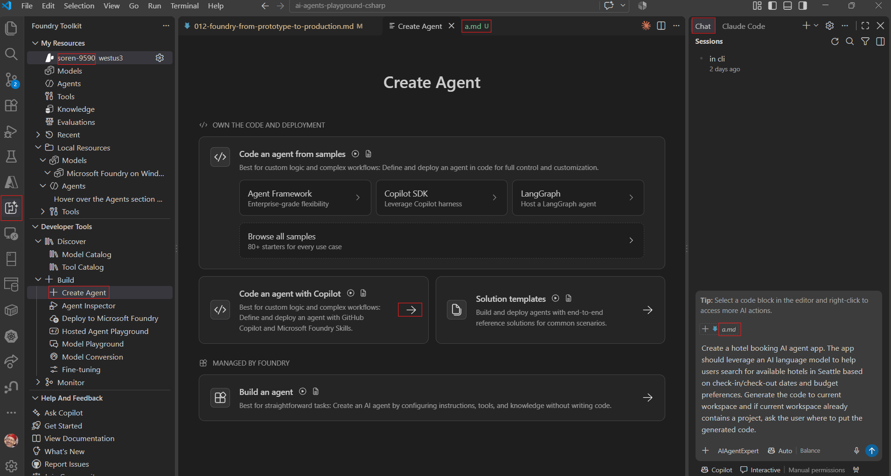

## Trying [From prototype to production: build and run agents at scale](https://build.microsoft.com/en-US/sessions/BRK241?source=sessions)
  * [Slides](https://medius.microsoft.com/video/asset/PPT/af92c987-5029-4a5f-8a59-4a3931941ce5)

### PreReqs
* 010 [VS Code having Azure and Foundry Toolkit extension](010-setup.md)
  * Logged into
    * Github (for Copilot)
    * az (to reach resouces)
    * azd (to deploy our app)
  * Installed [`Foundry Skills`](https://www.skills.sh/microsoft/azure-skills/microsoft-foundry)
* 011 [setup a project in Foundry](011-no-deploy-quickstart.md)
  * Mine is called `soren-9590`

### Try it out
* In VS Code
  * Create folder `012-foundry-from-prototype-to-production` to hold files for this project
    * create dummy file `a.md` in the folder
  * Left-menu - Azure - select `Microsoft Foundry` - expand then right-click `soren-9590` - open in Foundry Toolkit
  * Test Foundry skills
    * Test azd - In copilot chat ask:`What AI models are available in Microsoft Foundry?`
      * A:`Your selected Foundry project (soren-9590) currently has no models deployed.`
    * Test az - In copilot chat ask:`List my Azure resource groups`
    * More uses of [Foundry skills](https://learn.microsoft.com/en-us/azure/foundry/how-to/develop/use-microsoft-foundry-skill?tabs=vscode#use-the-skill-in-a-project)
  * Left-menu - Foundry Toolkit - Developer Tools - Create Agent - `Create Agent with CoPilot`.
    * -> this opens the copilot chat with some instruction 
    
    * Open file `a.md`, so that copilot can know where to put files.
    * Replace the text for copilot with `Help me create an agent that can act as a field operations agent that connects to WorkIQ, FabricIQ, FoundryIQ, and Content Understanding to help field representativescdiagnoses fiber issues. Write in C# with Microsoft Agent Framework. Generate the code to folder, where a.md exists.`
    * Out:
    ```
    Created the C#/.NET 10 Microsoft Agent Framework project in the directory containing a.md.
      * FiberFieldOpsAgent.csproj and Program.cs set up the hosted agent and Foundry toolbox integration. 
      * FieldOperationsInstructions.cs defines evidence-led fiber troubleshooting, safe-check guidance, and escalation criteria. 
      * ContentUnderstandingAnalyzer.cs adds an agent-callable Content Understanding tool for HTTPS-accessible field evidence. 
      * .env.example and README.md document configuration, including Work IQ, Fabric IQ, and Foundry IQ toolbox setup.
    Verification: dotnet build succeeded with 0 warnings and 0 errors; `dotnet format --verify-no-changes` passed.
    The agent code is ready, but the external connections and a deployed model still need configuration. The selected Foundry project currently has no deployed models; configure the values in .env and create the toolbox connections before running it against live services. I left unrelated existing worktree changes untouched; the repository-wide whitespace check also reports a trailing-space issue in an existing, out-of-scope README.
    ```

#### Refs
* Original text from `Create Agent with CoPilot`:
```llm
Create a hotel booking AI agent app. The app should leverage an AI language model to help users search for available hotels in Seattle based on check-in/check-out dates and budget preferences. Generate the code to current workspace and if current workspace already contains a project, ask the user where to put the generated code.
```

WIP

---
