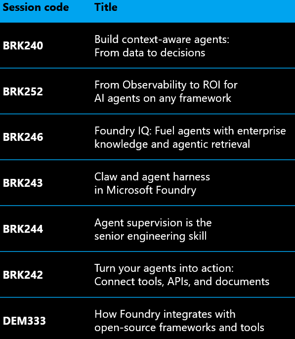

## Trying out session [BRK241: From prototype to production: build and run agents at scale](https://build.microsoft.com/en-US/sessions/BRK241?source=sessions)
  * [Slides](https://medius.microsoft.com/video/asset/PPT/af92c987-5029-4a5f-8a59-4a3931941ce5)

### PreRequisites
* 010 [VS Code having Azure and Foundry Toolkit extension](010-setup.md)
  * Logged into
    * Github (for Copilot)
    * az (to reach resouces)
    * azd (to deploy our app)
  * Installed [`Foundry Skills`](https://www.skills.sh/microsoft/azure-skills/microsoft-foundry)
* 011 [setup a project in Foundry](011-no-deploy-quickstart.md)
  * Mine is called `soren-9590`

### What is Foundry?
* [Intro](https://learn.microsoft.com/en-us/azure/foundry/what-is-foundry)

### Try it out
#### Create Agent
* In VS Code
  * Create folder `012-foundry-from-prototype-to-production` to hold files for this project
    * create dummy file `a.md` in the folder
  * Left-menu - Azure - select `Microsoft Foundry` - expand then right-click `soren-9590` - open in Foundry Toolkit
  * Test Foundry skills
    * Test azd - In copilot chat ask:`What AI models are available in Microsoft Foundry?`
      * A:`Your selected Foundry project (soren-9590) currently has no models deployed.`
    * Test az - In copilot chat ask:`List my Azure resource groups`
    * More uses of [Foundry skills](https://learn.microsoft.com/en-us/azure/foundry/how-to/develop/use-microsoft-foundry-skill?tabs=vscode#use-the-skill-in-a-project)
  * Left-menu - Foundry Toolkit - Developer Tools - Create Agent - `Create Agent with CoPilot`.
    * -> this opens the copilot chat with some instruction 
    
    * Open file `a.md`, so that copilot can know where to put files.
    * Replace the text for copilot with 
    ```llm
    Help me create an agent that can act as a field operations agent that connects to WorkIQ, FabricIQ, FoundryIQ, and Content Understanding to help field representativescdiagnoses fiber issues. Write in C# with Microsoft Agent Framework. Generate the code to folder, where a.md exists.
    ```
    * Out:
    ```out
    I’ll create the agent in the directory containing a.md, first checking the local Foundry tooling and current project context, then I’ll scaffold a C# Microsoft Agent Framework app with clearly isolated integration adapters for the four named services.

    Created the C#/.NET 10 Microsoft Agent Framework project in the directory containing a.md.
      * FiberFieldOpsAgent.csproj and Program.cs set up the hosted agent and Foundry toolbox integration. 
      * FieldOperationsInstructions.cs defines evidence-led fiber troubleshooting, safe-check guidance, and escalation criteria. 
      * ContentUnderstandingAnalyzer.cs adds an agent-callable Content Understanding tool for HTTPS-accessible field evidence. 
      * .env.example and README.md document configuration, including Work IQ, Fabric IQ, and Foundry IQ toolbox setup.
    Verification: dotnet build succeeded with 0 warnings and 0 errors; `dotnet format --verify-no-changes` passed.
    The agent code is ready, but the external connections and a deployed model still need configuration. The selected Foundry project currently has no deployed models; configure the values in .env and create the toolbox connections before running it against live services. I left unrelated existing worktree changes untouched; the repository-wide whitespace check also reports a trailing-space issue in an existing, out-of-scope README.
    ```

The agent we created needs all these tools Work IQ, Fabric IQ, and Foundry IQ toolbox.  
It is pretty waige howto
* deploy the tools and the agent
* secure the access to agent and tools
* limit/filter what the tools are allowed to fetch of data
* and much more
Perhaps the rest of the vid reveals something more.

* Refs
  * Original text from `Create Agent with CoPilot`:
  ```llm
  Create a hotel booking AI agent app. The app should leverage an AI language model to help users search for available hotels in Seattle based on check-in/check-out dates and budget preferences. Generate the code to current workspace and if current workspace already contains a project, ask the user where to put the generated code.
  ```
  * [Foundry Agent Solution Templates](https://github.com/microsoft/Foundry-Agent-Solution-Templates/tree/main#foundry-agent-solution-templates) templates you can use with `Create Agent with Solution templates` instead of `Create Agent with CoPilot`:  

  | Template | Description |
  |---|---|
  | 1. [Private-network Hosted Agent](private-network-hosted-agent/) | Demonstrates security and data-protection controls for a Hosted Agent solution, including VNet isolation, private endpoints, restricted egress, managed identity, and customer-managed keys. |
  | 2. [APIM-hosted Foundry Agent](apim-hosted-agent/) | Demonstrates governed agent, model, and tool traffic through API Management. |
  | 3. [Enterprise Knowledge Agent](enterprise-knowledge-agent/) | Demonstrates grounding with custom data from Fabric, databases, org APIs, and Microsoft IQs, and shows a typical RAG setup with a hosted agent, including connection and authentication best practices. |
  | 4. Multi-agent *(coming soon)* | Demonstrates multi-agent patterns with agent-to-agent (A2A) orchestration, agent registry and endpoints, A2A/Model Context Protocol (MCP) routing, shared observability, cross-agent authentication, and governance policies. |
  | 5. Regulated/Sovereign Agent *(coming soon)* | Demonstrates an agent setup for strict data residency and private deployments in regulated environments. |
  | 6. LangChain/LangGraph based hosted agent *(coming soon)* | Demonstrates a hosted agent built with LangChain/LangGraph stack, with compatible observabilities, and different options to host on Foundry. |
  | 7. Auditable self-managed agent with observability *(coming soon)* | Demonstrates integrating a hosted agent with self-managed observability for operations and FinOps, including exporting telemetry to popular third-party analytics stores. |
  | 8. Self-improving Agent *(coming soon)* | Demonstrates a secure flow using real-world data to perform RL/Fine-tuning on deployed agents and models in production. |
  | 9. Dev/test/prod environments with CI/CD *(coming soon)* | Demonstrates isolated dev/test/prod environments for Foundry Agents and how to link them via CI/CD. |
  | 10. Multiple clients for a Foundry Hosted Agent *(coming soon)* | Demonstrates a Foundry hosted agent backend with recommended patterns for serving user experiences via Teams, Microsoft 365, web, and mobile clients, including auth and protocol setup. |

#### 10:20 Tools = MCP servers
* Tools are MCP servers.
* A Toolbox is a *collection of tools* reached through *one* MCP endpoint

#### 20:05 Take it to prod - deploy

Durable workflows with human approvals.  
Ask for status through Teams.  

#### 27:15 

Routines: From ReActive to ProActive

#### 29:15 Visibility  
* Trajectories. Where are time and tokens spend?
* `azd ai agent eval init` // build an eval profile, `eval.yaml`
  * Choose agent service: field-ops-agent or fibey-coordinator.
  * There is a catalog of evaluators to choose from e.g. Tool-Selection-Evaluator.
  * Ask it to generate an eval dataset automatically. It will then choose relevant evaluators.

* `azd ai agent optimize`
  * input:
    * Choose agent service: field-ops-agent or fibey-coordinator.
    * Use the `eval.yaml`?
    * Use `instructions.md` for sample instructions.
    * Enter skill folder?
    * Use Tools file `tools.json`?
    * Use specific LLM?
  * output:
    * a report giving proposals for optimizations, that you then can deploy
  * deploy optimizations:
    * `azd ai agent optimize deploy --candidate cand_qwerty123 --agent field-ops-agent`

So this is really convenient - not the least, when you want to change LLM every second month to save money.

#### 38:10 What just happened?

We ended up publishing the agent to Teams

## Other agent sessions
[](https://build.microsoft.com/en-US/sessions?filter=topic%2FlogicalValue%3EAgents+%26+apps)

## [LinkedIn Post](https://www.linkedin.com/feed/update/urn:li:share:7516432112141627393/)

---
## Next up
* 013 [Tutorial: Idea to prototype](013-agent-with-decision-mcp.md)
