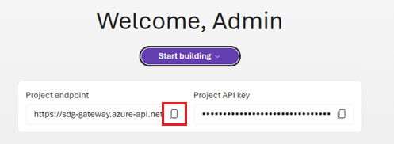
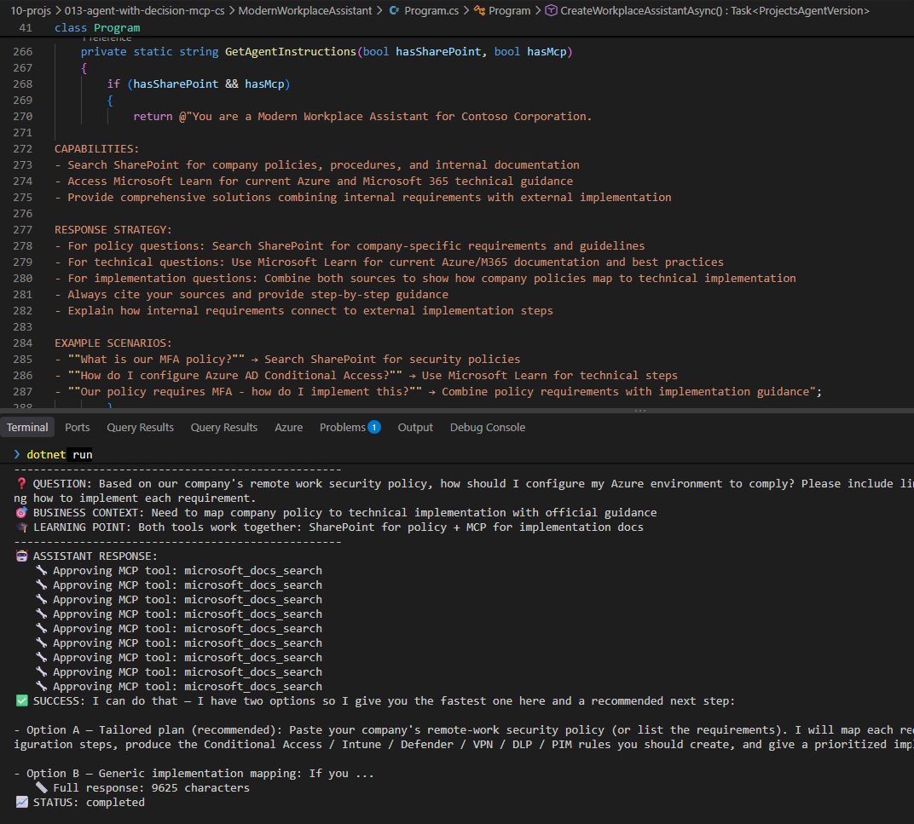
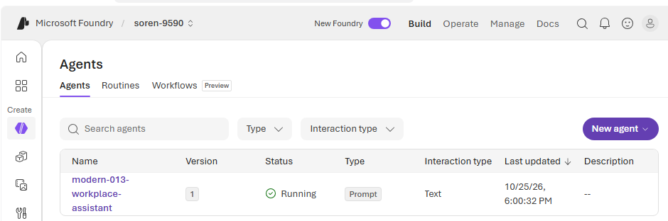
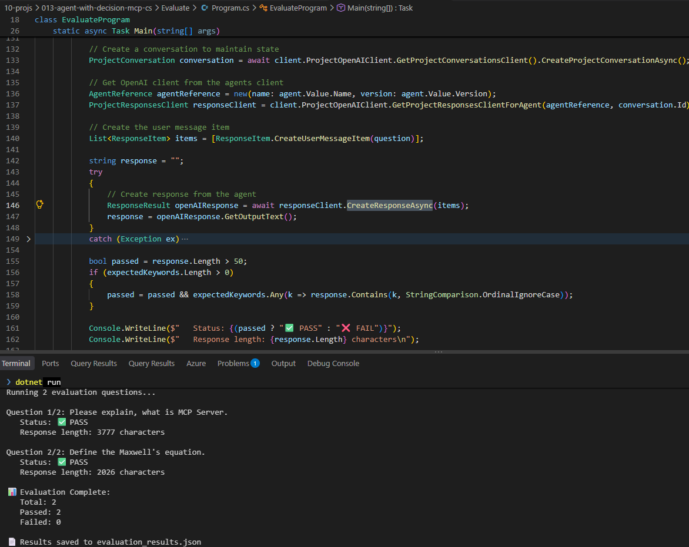

## [Tutorial: Idea to prototype](https://learn.microsoft.com/en-us/azure/foundry/tutorials/developer-journey-idea-to-prototype?tabs=python)

### Here is info from the tutorial

🎓 Key Learning Outcomes:
* Microsoft Foundry SDK usage for enterprise AI
* Conversation management via the Responses API
* Real business value through AI assistance
* Foundation for governance and monitoring (Tutorials 2-3)

Business scenario: Create an AI assistant that helps employees by combining:
* Company policies (from SharePoint documents)
* Technical implementation guidance (from Microsoft Learn via MCP)
* Complete solutions (combining both sources for business implementation)
* Batch evaluation to validate agent performance on realistic business scenarios

You will:
* Build a Modern Workplace Assistant with SharePoint and MCP integration.
* Demonstrate real business scenarios combining internal and external knowledge.
* Implement robust error handling and graceful degradation.
* Create evaluation framework for business-focused testing.
* Prepare foundation for governance and production deployment.

### Try it out

I'll omit the connection to a SharePoint project.

#### [Prerequisites](https://learn.microsoft.com/en-us/azure/foundry/agents/concepts/cli-agent-development)

* [Setup for foundry](010-setup.md)
* You have a [Foundry project in `West US 3`](011-no-deploy-quickstart.md), which gives instant models.
  * Setup of `Python` and `TypeScript` projects was also demoed in that quickstart.
  * I'll be using project `https://soren-9590-resource.services.ai.azure.com/api/projects/soren-9590`.
* The `Foundry User` role to create and test the agent. If you create a project connection to authenticate an MCP server, you also need the `Foundry Project Manager` role.
  * [Assign Foundry User role to your user principal](https://learn.microsoft.com/en-us/azure/foundry/concepts/rbac-foundry?tabs=owner%2Cfoundry#minimum-role-assignments-to-get-started)

Verify [CLIs](https://learn.microsoft.com/en-us/azure/foundry/agents/concepts/cli-agent-development)
```ps1
az -v
# azure-cli                         2.91.0

azd version   
# azd version 1.37.1

azd ai -h
# Commands for the ai extension namespace.
```

Verify [foundry skill](https://learn.microsoft.com/en-us/azure/foundry/how-to/develop/use-microsoft-foundry-skill?tabs=coding-agents#verify-the-setup)
```bash
# bash
az login
# Subscription: xxx

azd auth login
# Logged in to Azure as xxx
```
In CoPilot LLM
```llm
Use Microsoft-Foundry Skill to see which AI projects I have
```
`Project: soren-9590`


#### Get sample code

Sparse checkout only this tutorial - reduced download

```bash
git clone --no-checkout https://github.com/microsoft-foundry/foundry-samples.git
cd foundry-samples
git sparse-checkout init --cone
git sparse-checkout set samples/csharp/enterprise-agent-tutorial/1-idea-to-prototype
git checkout
cd samples/csharp/enterprise-agent-tutorial/1-idea-to-prototype
```

Copy the samples to here
```bash
cd 10-projs
mkdir 013-agent-with-decision-mcp-cs
cd 013-agent-with-decision-mcp-cs
# Copy the samples to here
xcopy ..\..\..\foundry-samples\samples\csharp\enterprise-agent-tutorial\1-idea-to-prototype . /E /I
```

But above was not enough. Many things changed.  
`Azure.AI.Projects.OpenAI` was moved to `Azure.AI.Extensions.OpenAI` and several object changed names and som props were replaced by methods.  
I have updated the code. 

You also need to set environment settings:
```ini
# .env
# Foundry configuration
FOUNDRY_PROJECT_ENDPOINT=https://soren-9590-resource.services.ai.azure.com/api/projects/soren-9590
FOUNDRY_MODEL_NAME=gpt-5-mini

# SharePoint integration (optional - requires connection name)
# SHAREPOINT_CONNECTION_NAME=<your-sharepoint-connection-name>

# The Microsoft Learn MCP Server (optional)
MCP_SERVER_URL=https://learn.microsoft.com/api/mcp
```

Find your project endpoint on the welcome screen of the Foundry project.  


#### Run the samples

##### Run ModernWorkplaceAssistant

```ps1
cd ModernWorkplaceAssistant
dotnet restore
az login
azd auth login
dotnet run
```
Here is what it outputs:
```out
🚀 Azure AI Foundry - Modern Workplace Assistant
Tutorial 1: Building Enterprise Agents with SharePoint + MCP Tools
======================================================================

🤖 Creating Modern Workplace Assistant...
✅ Connected to Azure AI Foundry: https://soren-9590-resource.services.ai.azure.com/api/projects/soren-9590
📁 SharePoint integration skipped (SHAREPOINT_CONNECTION_NAME not set)
📚 Configuring Microsoft Learn MCP integration...
   Server URL: https://learn.microsoft.com/api/mcp
✅ MCP tool configured successfully
🛠️  Creating agent with model: gpt-5-mini
   ✓ MCP tool added
   Total tools: 1
✅ Agent created successfully: modern-013-workplace-assistant (version 1)

======================================================================
🏢 MODERN WORKPLACE ASSISTANT - BUSINESS SCENARIO DEMONSTRATION
======================================================================
This demonstration shows how AI agents solve real business problems
using the Azure AI Projects v2 SDK with the Responses API.
======================================================================

📊 SCENARIO 1/3: 📋 Company Policy Question (SharePoint Only)
--------------------------------------------------
❓ QUESTION: What is Contoso's remote work policy?
🎯 BUSINESS CONTEXT: Employee needs to understand company-specific remote work requirements
🎓 LEARNING POINT: SharePoint tool retrieves internal company policies
--------------------------------------------------
🤖 ASSISTANT RESPONSE:
   🔧 Approving MCP tool: microsoft_docs_search
   🔧 Approving MCP tool: microsoft_docs_fetch
✅ SUCCESS: There isn't a single page titled “Contoso remote work policy.” Contoso’s approach to remote work is implemented across several Microsoft 365 guidance pages. In short, their remote‑work policy is a security‑first, hybrid model that balances productivity and protection by using:

- Conditional Access and protection levels (Starting point, Enterprise, Specialized) that require MFA and device compliance for remote sign‑ins.
- Mobile device management (Intune) and BYOD controls so devices are enrolle...
   📏 Full response: 2346 characters
📈 STATUS: completed
--------------------------------------------------

📊 SCENARIO 2/3: 📚 Technical Documentation Question (MCP Only)
--------------------------------------------------
❓ QUESTION: According to Microsoft Learn, what is the correct way to implement Azure AD Conditional Access policies? Please include reference links to the official documentation.
🎯 BUSINESS CONTEXT: IT administrator needs authoritative Microsoft technical guidance
🎓 LEARNING POINT: MCP tool accesses Microsoft Learn for official documentation with links
--------------------------------------------------
🤖 ASSISTANT RESPONSE:
   🔧 Approving MCP tool: microsoft_docs_search
✅ SUCCESS: Short answer — follow Microsoft Learn’s recommended lifecycle: plan, design, test (report‑only/What If), deploy gradually, monitor, and govern policies. Key best practices include applying coverage to all apps, excluding emergency/break‑glass accounts, minimizingand consolidating policies, using groups/filters and templates, testing in report‑only, automating policy-as-code, and protecting policy changes. Relevant Microsoft Learn guidance:

Core guidance and planning
- Plan a Conditional Access...
   📏 Full response: 3644 characters
📈 STATUS: completed
--------------------------------------------------

📊 SCENARIO 3/3: 🔄 Combined Implementation Question (SharePoint + MCP)
--------------------------------------------------
❓ QUESTION: Based on our company's remote work security policy, how should I configure my Azure environment to comply? Please include links to Microsoft documentation showing how to implement each requirement.
🎯 BUSINESS CONTEXT: Need to map company policy to technical implementation with official guidance
🎓 LEARNING POINT: Both tools work together: SharePoint for policy + MCP for implementation docs
--------------------------------------------------
🤖 ASSISTANT RESPONSE:
   🔧 Approving MCP tool: microsoft_docs_search
   🔧 Approving MCP tool: microsoft_docs_search
   🔧 Approving MCP tool: microsoft_docs_search
   🔧 Approving MCP tool: microsoft_docs_search
   🔧 Approving MCP tool: microsoft_docs_search
   🔧 Approving MCP tool: microsoft_docs_search
   🔧 Approving MCP tool: microsoft_docs_search
   🔧 Approving MCP tool: microsoft_docs_search
   🔧 Approving MCP tool: microsoft_docs_search
   🔧 Approving MCP tool: microsoft_docs_search
   🔧 Approving MCP tool: microsoft_docs_fetch
   🔧 Approving MCP tool: microsoft_docs_fetch
   🔧 Approving MCP tool: microsoft_docs_fetch
   🔧 Approving MCP tool: microsoft_docs_fetch
   🔧 Approving MCP tool: microsoft_docs_fetch
   🔧 Approving MCP tool: microsoft_docs_fetch
   🔧 Approving MCP tool: microsoft_docs_fetch
   🔧 Approving MCP tool: microsoft_docs_fetch
   🔧 Approving MCP tool: microsoft_docs_fetch
   🔧 Approving MCP tool: microsoft_docs_search
✅ SUCCESS: I can do this two ways:

- Option A — I map your company’s exact remote-work security requirements to an Azure implementation plan (step‑by‑step, prioritized, with the exact Conditional Access/Intune/Firewall/PIM/DLP/Sentinel configs you need). For that I’ll need your policy text or the specific controls you must meet (e.g., “MFA for all remote access”, “block unmanaged devices from SharePoint”, “require just‑in‑time admin elevation”,“VPN must use client certs or Azure AD auth”, etc.).
- Option...
   📏 Full response: 10531 characters
📈 STATUS: completed
--------------------------------------------------

✅ DEMONSTRATION COMPLETED!
🎓 Key Learning Outcomes:
   • Azure AI Projects v2 SDK with PromptAgentDefinition
   • Responses API for agent conversations
   • SharePoint + MCP tool integration
   • MCP tool approval handling via the Responses API
   • Real business value through AI assistance
   • Foundation for governance and monitoring (Tutorials 2-3)

🎯 Try interactive mode? (y/n): n

🧹 Cleaning up agent...
✅ Agent deleted

🎉 Sample completed successfully!
📚 This foundation supports Tutorial 2 (Governance) and Tutorial 3 (Production)
🔗 Next: Add evaluation metrics, monitoring, and production deployment
```
  

You can read the code creates an agent in foundry, sends prompts to it and in the end deletes it.
Here you can see it in foundry web, while it is still running:
  

##### Run Evaluate

```ps1
cd ..
cd Evaluate
dotnet restore
az login
azd auth login
dotnet run
```
Here is what it outputs:
```out
🧪 Modern Workplace Assistant Evaluation

✅ MCP configured for evaluation

Running 2 evaluation questions...

Question 1/2: Please explain, what is MCP Server.
   Status: ✅ PASS
   Response length: 4527 characters

Question 2/2: Define the Maxwell's equation.
   Status: ✅ PASS
   Response length: 1672 characters

📊 Evaluation Complete:
   Total: 2
   Passed: 2
   Failed: 0

📄 Results saved to evaluation_results.json
```


This agent was not deleted by code, so you should manually do it.

## Refs
* [Agent Deployment Lifecycle](https://learn.microsoft.com/en-us/azure/foundry/agents/concepts/cli-agent-development#deployment-lifecycle)
* [Set up a Microsoft Foundry project in Visual Studio Code](https://learn.microsoft.com/en-us/azure/foundry/how-to/develop/set-up-foundry-project-visual-studio-code)
* [Microsoft Foundry Toolkit for Visual Studio Code overview](https://learn.microsoft.com/en-us/azure/foundry/how-to/develop/get-started-projects-visual-studio-code)

## [LinkedIn Post](https://www.linkedin.com/feed/update/urn:li:activity:7520421435253637121/)

---
## Next up
* 014 [Getting hole though to your MCP server](./014-mcp-mock.md)
