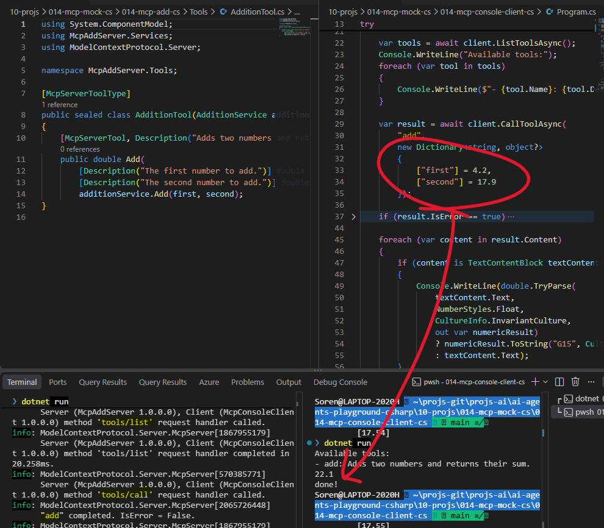

## 014 MCP Mock

In this exercise the objective was to get a mock MCP server in CS and a console app to test it.
Here the LLM created a plan and then the code for me.  
* Plan [MCP server](../10-projs/014-mcp-mock-cs/014-mcp-add-cs/plan.md)
* Plan [MCP client](../10-projs/014-mcp-mock-cs/014-mcp-console-client-cs/plan.md)

All what the MCP mock can do is add two numbers. The purpose was to be able to test a hole through between client and server.
Here is how it looked like, when running:  

## Refs
* Docs: [Building an MCP server](https://csharp.sdk.modelcontextprotocol.io/v2/concepts/getting-started.html)
* Github Samples: [modelcontextprotocol/csharp-sdk](https://github.com/modelcontextprotocol/csharp-sdk)
  * api.github [same](https://api.github.com/repos/modelcontextprotocol/csharp-sdk/contents/samples)

## [LinkedIn Post](...)

---
## Next up
* [Quickstart: Deploy your first hosted agent](https://learn.microsoft.com/en-us/azure/foundry/agents/quickstarts/quickstart-hosted-agent?pivots=csharp)
* [Quickstart: Chat with an agent in code](https://learn.microsoft.com/en-us/azure/foundry/quickstarts/get-started-code?tabs=csharp)
* [Building a Hosted Agent with GitHub Copilot and Microsoft Foundry](https://code.visualstudio.com/learn/foundry-toolkit-extension/4-building-hosted-agent)
* ChatGpt. Where? [Microsoft AI Agent Quickstart](chats/microsoft-ai-agent-deployment-chat.md)
  * [Quickstart: Deploy your own code as a hosted agent](https://learn.microsoft.com/en-us/azure/foundry/agents/quickstarts/quickstart-deploy-own-code)
  