## 016 [Quickstart: Build a toolbox and use it with a hosted agent](https://learn.microsoft.com/en-us/azure/foundry/agents/quickstarts/quickstart-toolbox-agent?pivots=vscode)

... This is still WIP ...

In this test We'll create a common interface to a group of MCP servers - also called a Toolbox.  
Then we will deploy it to Foundry and access it from 
1. Agent running locally in PC via  
  * [azd](https://learn.microsoft.com/en-us/azure/foundry/agents/quickstarts/quickstart-toolbox-agent?pivots=vscode)
  * [C#](https://learn.microsoft.com/en-us/azure/foundry/agents/quickstarts/quickstart-toolbox-agent?pivots=csharp)
2. Agent deployed to Foundry

### The python agent

Is python ready?
PS1:
```ps1
cd 10-projs
python --version
# Python 3.13.17
python -m pip --version
# pip 26.2.2
```
If not [prepare from 011](011-no-deploy-quickstart.md#chat-with-the-model-via-python)

#### 1. Initialize agent locally

How do we get the python agent set up?
First we fetch it.

Bash:
```bash
# retrieve a python demo agent
cd ./10-projs
mkdir 016-hosted-agent-py && cd 016-hosted-agent-py
azd ai agent init --template "https://github.com/microsoft-foundry/foundry-samples/blob/main/samples/python/hosted-agents/agent-framework/responses/04-foundry-toolbox/azure.yaml" --src .
```
This created `10-projs\016-hosted-agent-py\.azure\016-hosted-agent-py-dev\.env`.  
This is the agent settings file.  
Now update resource group to your resource group. You must use azd to do it right:  
```bash
azd env set AZURE_RESOURCE_GROUP <your resource group>
# changing name of agent, so it does not start with a number
azd env set AZURE_ENV_NAME hosted-agent-py-016-dev
```
Next lets try to fetch its dependencies and compile.
PS1:
```ps1
# import dependencies
python -m pip install agent_framework
python -m pip install azure.identity dotenv
cd src\agent-framework-agent-with-foundry-toolbox-responses
# check the project for syntax errors and generate bytecode files
python -m compileall main.py
```
If no errors the agent code is great.

The agent and toolbox needs **settings**.  
Some identities needs **permissions**.
You can get much of the picture from `10-projs\016-hosted-agent-py\azure.yaml`
[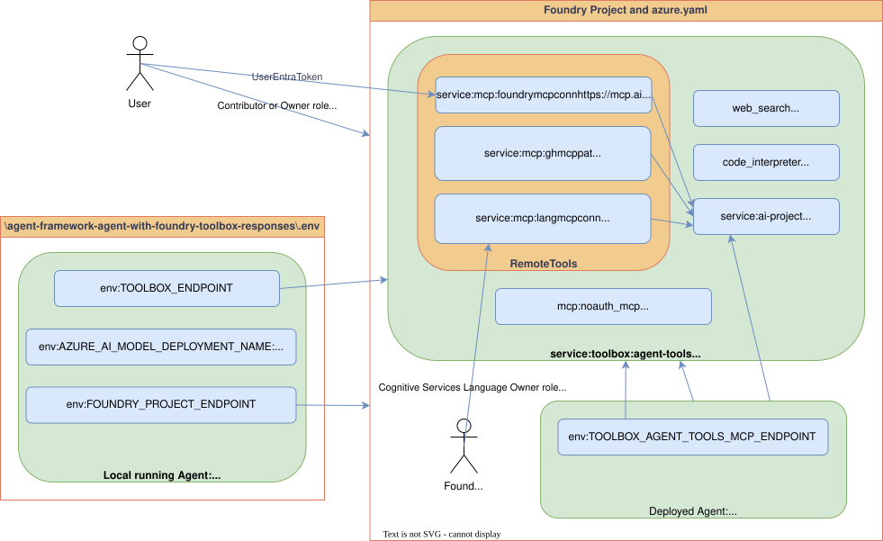](../10-projs/016-hosted-agent-py/azure.yaml)  
That `azure.yaml` is  also the `Infrastructure As Code` used for deploying the resources - the agent and the toolbox.

You can read about some of the **supported tools** in Foundry - click on this drawing:  
[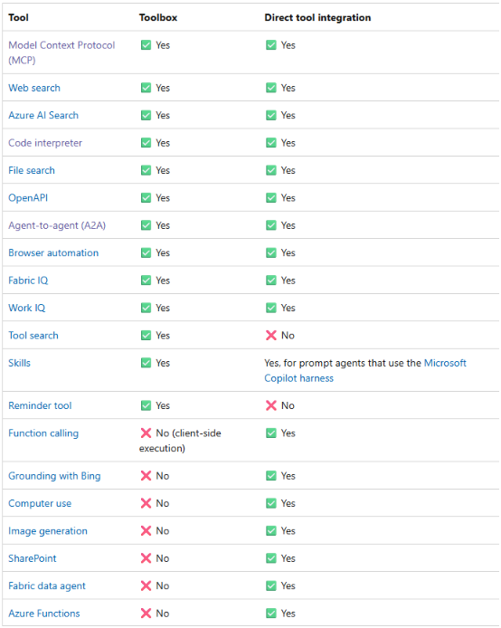](https://learn.microsoft.com/en-us/azure/foundry/agents/concepts/toolbox-overview#supported-tools)

|[env](../10-projs/016-hosted-agent-py/src/agent-framework-agent-with-foundry-toolbox-responses/)|GET|USE|
|---|---|---|
|input:GITHUB_MCP_PAT|[Create](https://github.com/settings/personal-access-tokens) a [fine-grained PAT](https://docs.github.com/en/authentication/keeping-your-account-and-data-secure/managing-your-personal-access-tokens#creating-a-fine-grained-personal-access-token) with only the repository permissions|[Use PAT](https://github.com/github/github-mcp-server#install-in-vs-code) in VSCode|

Info: Foundry stores connections details in a **managed Azure Key Vault** if no Key Vault connection is created.  
Users that prefer to manage their secrets themselves can bring their own Azure Key Vault via a connection. 

##### Tool: foundrymcpconn

The tool is used for controlling resources in Foundry.  
Here is a list of areas you can control with it.  
You need to have permissions for the things you want to do in Foundry.  
You could prompt: "List all agents in my Foundry project.", if you have `agent_get`-tool configured in your foundrymcpconn and if you have permission to read it.  
[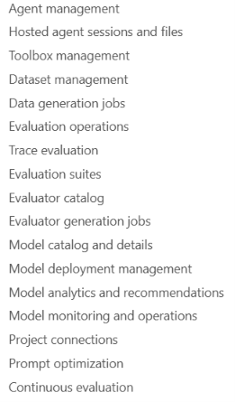](https://learn.microsoft.com/en-us/azure/foundry/mcp/available-tools?view=foundry#agent-management)

##### Tool: ghmcppat

The env:`GITHUB_MCP_PAT` is a token used from VSCode - then handed over to the agent, who then uses it.  
* In the table use link `fine-grained PAT` to create a PAT.  
* Then click buttom [VSCode Install server](https://github.com/github/github-mcp-server#remote-github-mcp-server).  
Just install it - don't grant it accees. 
* Find [JSON config for it here](https://github.com/github/github-mcp-server#install-in-vs-code)
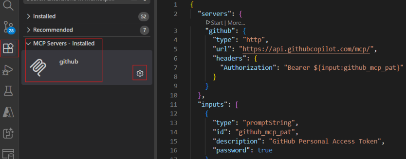
* Then in VSCode - Extensions - MCP Servers - Github
  * Press settings button - Show Configuration (JSON) - Paste the config you got.
  * Press settings button - Show configuration - Press settings button - Browse Resource
    * This will ask you to paste the PAT - do that
    * Now you dig into repos using the MCP

When you then use the MCP server (from the Local running Agent) it will ask for the PAT, so keep it ready.

I'll set 'GitHub' MCP up via Foundry Portal, so that credentials are stored in Foundry:  
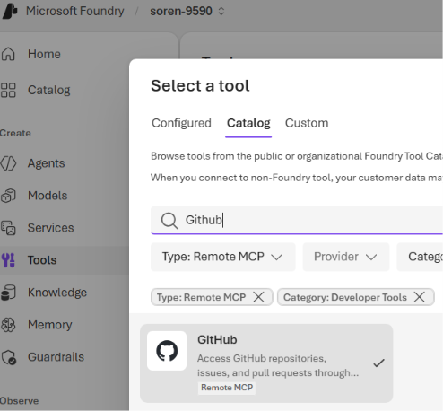  
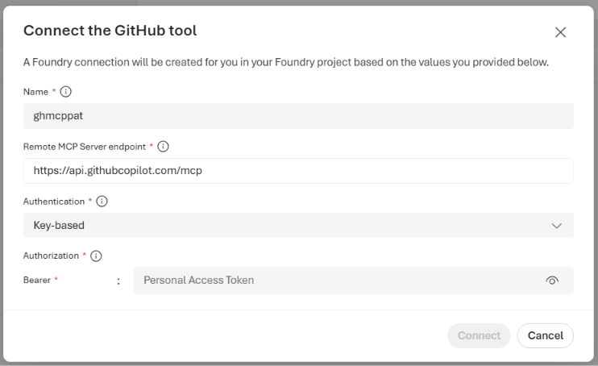

##### Tool: langmcpconn

env:AZURE_LANGUAGE_MCP_ENDPOINT

I'll set 'Azure Language in Foundry' MCP up via Foundry Portal, so that credentials are stored in Foundry:  
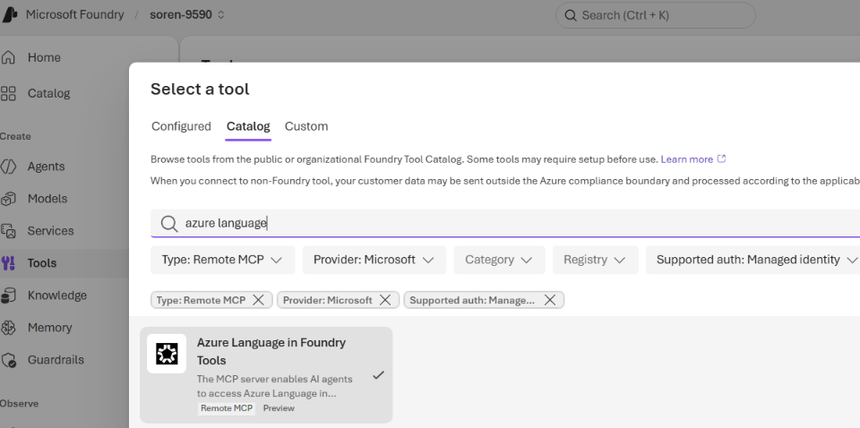  
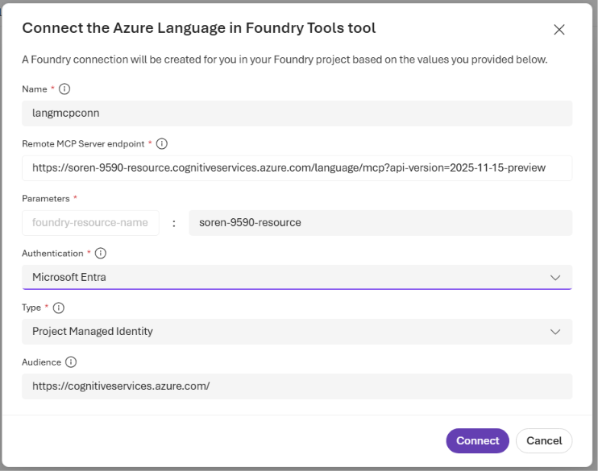

Now I can add to .env as used from azure.yaml:
```ini
AZURE_LANGUAGE_MCP_ENDPOINT="https://soren-9590-resource.cognitiveservices.azure.com/language/mcp?api-version=2025-11-15-preview"
```

The Foundry project managed identity also needs the **Cognitive Services Language Owner** role on the Azure Language resource. Assign the role at the Language resource scope (not the Foundry project scope). This is an Azure RBAC assignment, so use the Azure portal or `az`; `azd` does not provide a role-assignment command for this.

##### Assign the role in the Azure portal

1. Open the Language resource in the [Azure portal](https://portal.azure.com/). For this endpoint, the resource name is `soren-9590-resource`.
2. Select **Access control (IAM)** > **Add** > **Add role assignment**.
3. Select **Cognitive Services Language Owner**.
4. On **Members**, choose **Managed identity**, select the subscription and the Foundry project managed identity, then continue.
5. Select **Review + assign**.

The Foundry portal is where the remote MCP connection is configured; assign this Azure resource role through Azure RBAC. The account performing the assignment needs permission to create role assignments, such as **Role Based Access Control Administrator**, **User Access Administrator**, or **Owner** at the target scope.

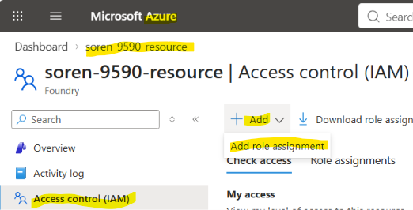  
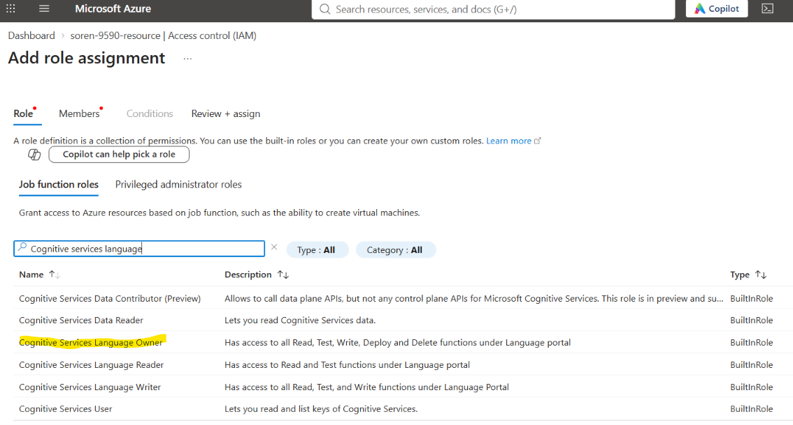  
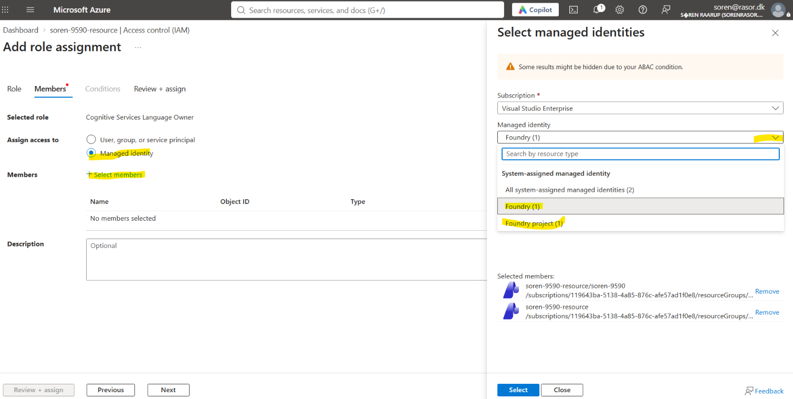  
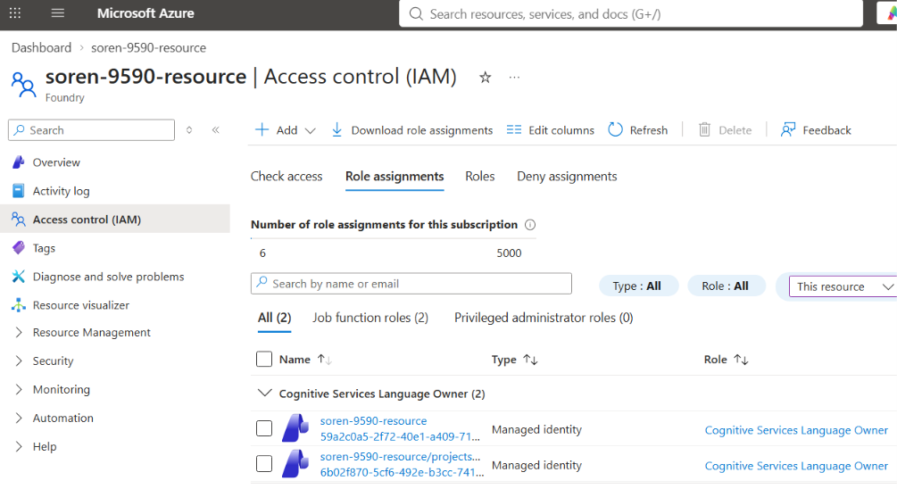  

##### Assign the role with Azure CLI (`az`)

Run in PowerShell after `az login`. Replace the resource group and Foundry account/project names with yours. The Language resource name below matches the endpoint above; use its actual name if it is a separate resource.

```powershell
$resourceGroup = "<resource-group>"
$foundryAccount = "<foundry-account-name>"
$foundryProject = "<foundry-project-name>"
$languageResource = "soren-9590-resource"

# The principal ID is the Foundry project's system-assigned managed identity.
$principalId = az cognitiveservices account project show `
  --name $foundryAccount `
  --resource-group $resourceGroup `
  --project-name $foundryProject `
  --query identity.principalId -o tsv
if (-not $principalId) { throw "No project managed identity principal ID was returned." }

# Use the Language resource's resource ID as the narrowest assignment scope.
$scope = az cognitiveservices account show `
  --name $languageResource `
  --resource-group $resourceGroup `
  --query id -o tsv
if (-not $scope) { throw "Could not resolve the Language resource ID." }

az role assignment create `
  --assignee-object-id $principalId `
  --assignee-principal-type ServicePrincipal `
  --role "Cognitive Services Language Owner" `
  --scope $scope
```

Check the assignment after it propagates:

```powershell
az role assignment list `
  --scope $scope `
  --assignee $principalId `
  --query "[?roleDefinitionName=='Cognitive Services Language Owner'].{Role:roleDefinitionName, Scope:scope}" `
  --output table
```

If the role or managed identity doesn't appear in the portal picker, confirm that you selected **Managed identity** and the correct Foundry project. The project identity can also be inspected with `az cognitiveservices account project show`. Role changes can take a few minutes to propagate.

##### Foundry remote MCP

I'll set 'Foundry' remote MCP up via Foundry Portal, so that credentials are stored in Foundry:  
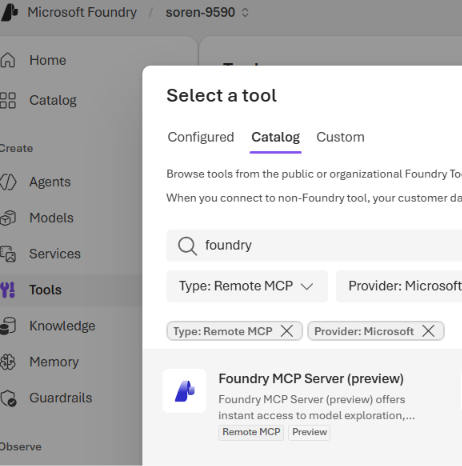  
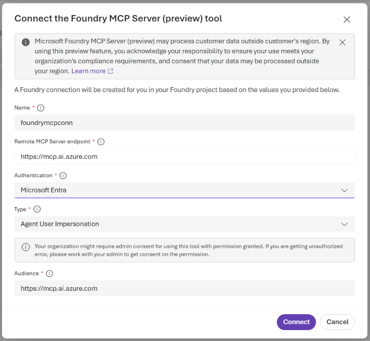

##### Tools available

In VSCode - Foundry Toolkit - Tools you can now see the added MCP tools and some built in tools:  
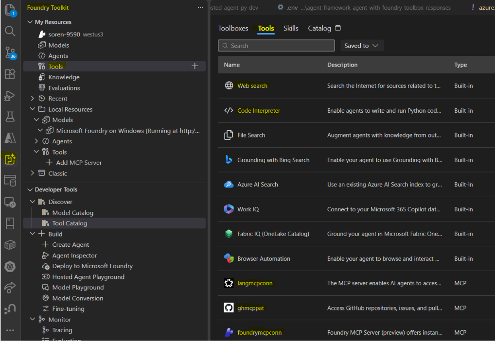

I expect the last MCP - 'noauth_mcp' - can be added automatic, when deploying, since there is no input, that is not in azure.yaml.

#### 2. Create toolbox

We could have used `azd ai toolbox create` to create a toolbox.  
Instead we want to use the declarations in `azure.yaml`

PS1:
```ps1
cd 016-hosted-agent-py
cd src\agent-framework-agent-with-foundry-toolbox-responses
az login
azd auth login
# set region same as where your Resource group
azd env set AZURE_LOCATION westus3
# upload template
azd provision

# if no errors deploy
# azd deploy --all

# verify deploy of toolbox succeeded by seeing this env have been set
# azd env get-value TOOLBOX_AGENT_TOOLS_MCP_ENDPOINT
```

Hmm.. some constraints in my setup between resource group and azure location for the azure.yaml ARM template gives errors, when provisioning...

Instead I'll create the toolbox in [Foundry Portal](https://ai.azure.com/).
* Tools - Toolboxes - Create Toolbox
* Name: agent-tools-016

Add the tools missing  
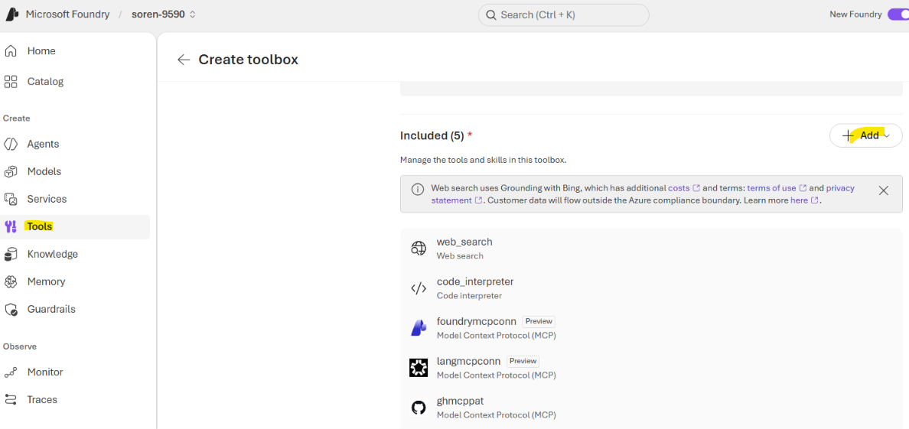

This gave med an endpoint which I can add to my agent settings:
```ps1
azd env set TOOLBOX_ENDPOINT https://soren-9590-resource.services.ai.azure.com/api/projects/soren-9590/toolboxes/agent-tools-016/mcp?api-version=v1
```

#### 3. Run agent locally 

PS1:
```ps1
cd src\agent-framework-agent-with-foundry-toolbox-responses
az login
# Compile and run
python main.py
```
Lots of json tracing was returned:
```log
2026-11-15 12:57:22,959 INFO azure.ai.agentserver: Tracing configured successfully via microsoft-opentelemetry distro.
...
2026-11-15 12:57:23,271 INFO hypercorn.error: Running on http://0.0.0.0:8088 (CTRL + C to quit)
CTRL + C
2026-11-15 13:05:43,312 INFO azure.ai.agentserver: AgentServerHost shutting down (graceful timeout=30s)
```

Lets get some help
```bash
azd ai agent --help
# v1.0.0-beta.19 
# Visit the docs at https://aka.ms/azd-ai-agent-docs

# Ship prompt, hosted, and voice agents with Microsoft Foundry from your terminal. (Preview)

# Usage
#   azd ai agent [command]

# Available Commands
#   code         : Manage agent source code. (Preview)
#   connection   : Manage connection service dependencies for an agent.
#   delete       : Delete a prompt, hosted, or voice agent.
#   doctor       : Diagnose problems with an azd ai agent project.
#   endpoint     : Inspect agent endpoints and manage hosted endpoint/card configuration.
#   eval         : Create and run quick evals for an agent.
#   files        : Manage files in a hosted agent session.
#   init         : Initialize a new prompt, hosted, or voice agent project. (Preview)
#   invocations  : Inspect and manage work created by invoking an agent.
#   invoke       : Send a message to your prompt or hosted agent.
#   monitor      : Monitor logs from a hosted agent.
#   optimize     : Evaluate and optimize AI agents.
#   pack         : Build a ready-to-sideload Teams app package for an activity agent.
#   publish      : Publish an activity agent as a Teams app to the Microsoft 365 store.
#   run          : Run your agent locally for development.
#   sample       : Browse the curated catalog of agent samples and azd templates.
#   sessions     : Manage sessions for a hosted agent endpoint.
#   show         : Show the status of a prompt, hosted, or voice agent.
#   state-stores : Inspect hosted-agent State Stores and manage their items.
#   toolbox      : Manage toolbox service dependencies for an agent.
#   version      : Prints the version of the application

# Global Flags
#   -C, --cwd string         : Sets the current working directory
#       --debug              : Enables debug and diagnostics logging
#   -e, --environment string : The name of the environment to use
#   -h, --help               : help for agent
#       --no-prompt          : Runs without prompts. Uses existing values; fails if any required value or decision cannot be resolved automatically.
#   -o, --output string      : The output format (default "default")

# Examples
#   Initialize and deploy an agent project
#     azd ai agent init
#     azd up

#   Send a message to a deployed prompt or hosted agent
#     azd ai agent invoke "Hello"

# Use azd ai agent [command] --help to view examples and more information about a specific command.

# Environments & Environment Variables
#   An azd environment is a named deployment configuration, such as dev or prod.
#   Its values are stored locally in .azure/<environment>/.env.
#   Use 'azd env new <name>' to create one, 'azd env select <name>' to change the
#   default, or --environment <name> (-e) to select one for a command.

#   Use 'azd env set <name> <value>' to save a value and 'azd env get-values' to
#   inspect the selected environment. Values can include secrets; do not share
#   the output or commit .azure to source control.

#   FOUNDRY_PROJECT_ENDPOINT identifies the Foundry project. Init records it
#   when you select an existing project; generated azure.yaml files reference
#   it as ${FOUNDRY_PROJECT_ENDPOINT} to keep configuration portable.
#   Deploy records AGENT_<SERVICE>_NAME, AGENT_<SERVICE>_VERSION and
#   AGENT_<SERVICE>_PROJECT_ENDPOINT so commands can resolve deployed agents.
#   <SERVICE> is the service name in uppercase with spaces and hyphens replaced
#   by underscores (for example, my-agent becomes MY_AGENT).

#   For hosted agent runtime settings, use the service-level env mapping in
#   azure.yaml. Reference environment values with ${VARIABLE_NAME}; setting an
#   azd environment value alone does not forward every value to the agent.
#   Use 'azd ai agent run' for local development and 'azd deploy' to apply changes
#   to the deployed agent.

# Learn More
#   Agent documentation: https://aka.ms/azd-ai-agent-docs
```

Lets learn some more...
```bash
azd ai agent endpoint show
# ERROR: no Foundry project endpoint resolved
# Suggestion: persist a workspace default with `azd ai project set <endpoint>`, or set FOUNDRY_PROJECT_ENDPOINT in the active azd environment, or export FOUNDRY_PROJECT_ENDPOINT in your shell

azd env set FOUNDRY_PROJECT_ENDPOINT https://soren-9590-resource.services.ai.azure.com/api/projects/soren-9590
azd env set AZURE_AI_MODEL_DEPLOYMENT_NAME gpt-5-mini
azd env set TOOLBOX_ENDPOINT https://soren-9590-resource.services.ai.azure.com/api/projects/soren-9590/toolboxes/agent-tools-016/mcp?api-version=v1

azd ai agent endpoint show
# ERROR: failed to get agent "agent-framework-agent-with-foundry-toolbox-responses": GET https://soren-9590-resource.services.ai.azure.com/api/projects/soren-9590/agents/agent-framework-agent-with-foundry-toolbox-responses
```
Wrong command - we checked if the agent was deployed. It is not deployed. We just want to run it locally atm.

So - run the agent locally:
```bash
cd src\agent-framework-agent-with-foundry-toolbox-responses
az login
azd ai agent run                           # Run locally on http://localhost:8088
```
```log
Detected python project. Start command: python main.py
Synchronizing dependencies (uv.lock)...
  ✓ Dependencies synchronized (uv.lock)
Starting agent on http://localhost:8088 (Ctrl+C to stop)
...
[2026-11-16 13:25:57 +0100] [20488] [INFO] Running on http://0.0.0.0:8088 (CTRL + C to quit)
Agent ready. In another terminal, try:

Next:
  azd ai agent invoke --local '<payload>'
  send a sample request to the running agent

  curl http://localhost:<port>/invocations/docs/openapi.json
  tip: inspect the spec to learn the agent's exact payload
```

A local webpage for interacting with the local agent pupped up
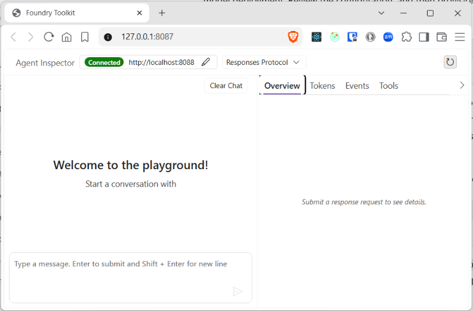

Sent it this message: "List the tools you can use.".
It fetched two tools and failed on 3:
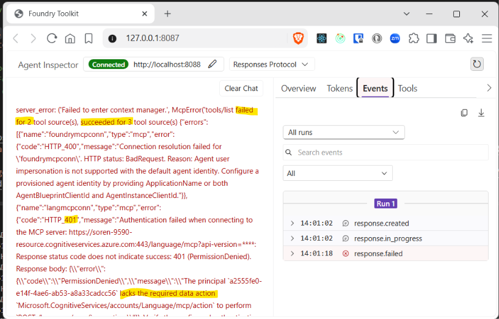

So seemingly we have hole through to the toolbox, but are having some issues with permissions on some tools.  

Well I added the instructions for adding role 'Cognitive Services Language Owner' Foundry ProjectManagedIdentity after I saw it failing here, so you can just [scroll up and see it there](#assign-the-role-in-the-azure-portal).

One (error) down - one to go.

Lets try once more.

Start the agent locally as before.  

Then lets try to call the local agent from another console instead of using the local UI:
```bash
# in another console:
cd src\agent-framework-agent-with-foundry-toolbox-responses
az login
azd ai agent invoke --local "List the tools you can use." # Test the local agent
```
```log
Target:       localhost:8088 (local)
Message:      "List the tools you can use."
Session:      8c3c2dc8-4f90-4466-8914-83b762ad9c18
Conversation: c912200a-1d50-4b06-b8a3-92577eeefad9

WARNING: A new version of extension 'Foundry agents (Beta)' is available: 1.0.0-beta.19 -> 1.1.0
  • To update: azd extension update azure.ai.agents
  • To update all: azd extension update --all

ERROR: agent failed (server_error): ('Failed to enter context manager.', McpError('tools/list failed for 1 tool source(s), succeeded for 4 tool source(s) {"errors":[{"name":"foundrymcpconn","type":"mcp","error":{"code":"HTTP_400","message":"Connection resolution failed for \'foundrymcpconn\'. HTTP status: BadRequest. Reason: Agent user impersonation is not supported with the default agent identity. Configure a provisioned agent identity by providing ApplicationName or both AgentBlueprintClientId and AgentInstanceClientId."}}]}'))
Update available: 1.37.1 -> 1.37.3 (Release notes)
To update, run `winget upgrade Microsoft.Azd`
```

#### Why `az login` did not fix this error

`az login` signs the developer in to Azure CLI. The sample's `DefaultAzureCredential` can use that sign-in to get the bearer token for the agent-to-toolbox request (scope `https://ai.azure.com/.default`). The `foundrymcpconn` connection then uses `UserEntraToken` to pass the caller's Entra identity on to Foundry MCP.

Those are separate from the identity of the agent itself. This HTTP 400 says the local agent host is using its **default agent identity**, which doesn't support this user-impersonation connection. It is not a missing `Cognitive Services Language Owner` role, a bad MCP scope, or a request to give the agent your Azure CLI credentials. The connection and toolbox can exist while the agent that calls them has not yet been provisioned.

The [quickstart's local-run step](https://learn.microsoft.com/en-us/azure/foundry/agents/quickstarts/quickstart-toolbox-agent?pivots=vscode) assumes the user-impersonation connection can resolve a provisioned agent identity. In this setup, `azd ai agent endpoint show` reported that no agent existed, and only the toolbox had been created in the portal. Deploying the hosted agent is the quickstart's way to provision that identity, but it is not the only way to run the code locally: if you already have a provisioned identity for an agent in this Foundry project, configure the local toolbox client to identify itself as that agent. The identity can be supplied as `ApplicationName` or as **both** `AgentBlueprintClientId` and `AgentInstanceClientId`; providing only one ID is insufficient.

##### Local-only option when an agent identity already exists

The current `FoundryToolbox` supports a `header_provider`. It adds the agent identity header to toolbox requests while `DefaultAzureCredential` continues to provide the caller's `https://ai.azure.com/.default` token:

```python
def toolbox_identity_headers(_runtime_kwargs):
    return {"ApplicationName": os.environ["FOUNDRY_APPLICATION_NAME"]}

toolbox = FoundryToolbox(
    credential,
    header_provider=toolbox_identity_headers,
)
```

Set `FOUNDRY_APPLICATION_NAME` to the name of an **existing, provisioned Foundry agent identity** in this project; do not use an arbitrary name. If using the client-ID form instead, return both headers from the provider:

```python
def toolbox_identity_headers(_runtime_kwargs):
    return {
        "AgentBlueprintClientId": os.environ["FOUNDRY_AGENT_BLUEPRINT_CLIENT_ID"],
        "AgentInstanceClientId": os.environ["FOUNDRY_AGENT_INSTANCE_CLIENT_ID"],
    }
```

The portal can create a Foundry agent and its identity without deploying this local Python source as a hosted agent. The identity still must actually exist; if the project has no provisioned agent identity, there is no local setting or `az login` option that can manufacture one. See [Agent identity concepts](https://learn.microsoft.com/en-us/azure/foundry/agents/concepts/agent-identity) for when Foundry provisions identities. With a suitable identity configured, keep `FOUNDRY_PROJECT_ENDPOINT`, `AZURE_AI_MODEL_DEPLOYMENT_NAME`, and `TOOLBOX_ENDPOINT` set, start the app locally, and invoke it with `azd ai agent invoke --local`.

##### Recommended fix: deploy the sample with `azd`

Run from the initialized project directory containing `azure.yaml` (`10-projs\016-hosted-agent-py`), not from `src`:

```powershell
azd auth login
azd provision
# Grant the project managed identity the Language role described above, if not already done.
azd deploy --all
```

`azd deploy --all` deploys the connections, toolbox, and hosted agent declared in `azure.yaml`, provisioning the identity as part of that flow. If you use this route, let the manifest create and bind its toolbox rather than overriding its endpoint with a different portal-created toolbox. After deployment, run locally and invoke from separate terminals:

```powershell
# Terminal 1, from the project directory
azd ai agent run

# Terminal 2, from the same project directory
azd ai agent invoke --local "List the tools you can use."
```

Keep `az login` for the Python `DefaultAzureCredential` user sign-in as well. `azd auth login` authenticates the Azure Developer CLI; neither login provisions the agent identity by itself.

##### Portal option

The Foundry portal can create an agent in the same project and provision its identity without deploying this local Python source. Creating a toolbox and its connections alone does not create an agent identity. After creating the agent, configure the local `FoundryToolbox` identity header as described above and keep the local project pointed at that same Foundry project and toolbox. Alternatively, the Foundry Toolkit's **Deploy Hosted Agent** flow or `azd deploy --all` deploys the hosted agent and provisions its identity as part of that deployment.

The Azure portal is not the fix for this 400: use it for Azure RBAC assignments such as the Language-resource role above. The Foundry MCP connection uses the signed-in user's access; assigning a role to the project managed identity does not supply that user context. `azd` deploys the agent declared in `azure.yaml`; `az` is useful for Azure RBAC operations, but does not provision this agent identity. For the connection's user-token behavior, see [Foundry MCP authentication](https://learn.microsoft.com/en-us/azure/foundry/agents/how-to/mcp-authentication). Never substitute an Azure CLI token or invented identity IDs for the provisioned agent identity.

I did CTRL + C to stop local agent. This asked me to update:
```log
WARNING: A new version of extension 'Foundry Agent Inspector (Beta)' is available: 1.0.0-beta.8 -> 1.0.0
  • To update: azd extension update azure.ai.inspector
  • To update all: azd extension update --all

WARNING: A new version of extension 'Foundry agents (Beta)' is available: 1.0.0-beta.19 -> 1.1.0
  • To update: azd extension update azure.ai.agents
  • To update all: azd extension update --all

Update available: 1.37.1 -> 1.37.3 (Release notes)
To update, run `winget upgrade Microsoft.Azd`
```

```bash
# azd ai agent invoke --local "Find the latest release notes for the Azure CLI on the web."

# azd deploy                                 # Deploy to Foundry
# azd ai agent invoke "your message"         # Invoke the deployed agent
```

### References
* [Role-based access control for Microsoft Foundry](https://learn.microsoft.com/en-us/azure/foundry/concepts/rbac-foundry?tabs=owner%2Cfoundry)
* [Role-based access control for Azure Language](https://learn.microsoft.com/en-us/azure/ai-services/language-service/concepts/role-based-access-control)
* [Azure CLI: `az cognitiveservices account project`](https://learn.microsoft.com/en-us/cli/azure/cognitiveservices/account/project?view=azure-cli-latest)
* [Azure CLI: `az role assignment`](https://learn.microsoft.com/en-us/cli/azure/role/assignment?view=azure-cli-latest)
* [Configure keyless authentication with Microsoft Entra ID](https://learn.microsoft.com/en-us/azure/foundry/foundry-models/how-to/configure-entra-id?tabs=python&pivots=ai-foundry-portal)
* [MCP — Microsoft Entra (Agent Identity / Project Managed Identity)](https://github.com/microsoft-foundry/foundry-samples/blob/main/samples/python/hosted-agents/SUPPORTED_TOOLBOX_SCENARIOS/tools/mcp-microsoft-entra.md)

---