## 016 [Quickstart: Build a toolbox and use it with a hosted agent](https://learn.microsoft.com/en-us/azure/foundry/agents/quickstarts/quickstart-toolbox-agent?pivots=vscode)

... This is still WIP ...

In this test We'll create a common interface to a group of MCP servers - also called a Toolbox.  
Then we will deploy it to Foundry and access it from 
1. Agent running locally in PC via  
  * [azd](https://learn.microsoft.com/en-us/azure/foundry/agents/quickstarts/quickstart-toolbox-agent?pivots=vscode)
  * [C#](https://learn.microsoft.com/en-us/azure/foundry/agents/quickstarts/quickstart-toolbox-agent?pivots=csharp)
2. Agent deployed to Foundry

### The python agent

Is python ready?
PS1:
```ps1
cd 10-projs
python --version
# Python 3.13.17
python -m pip --version
# pip 26.2.2
```
If not [prepare from 011](011-no-deploy-quickstart.md#chat-with-the-model-via-python)

#### 1. Initialize agent locally

How do we get the python agent set up?
First we fetch it.

Bash:
```bash
# retrieve a python demo agent
cd ./10-projs
mkdir 016-hosted-agent-py && cd 016-hosted-agent-py
azd ai agent init --template "https://github.com/microsoft-foundry/foundry-samples/blob/main/samples/python/hosted-agents/agent-framework/responses/04-foundry-toolbox/azure.yaml" --src .
```
This created `10-projs\016-hosted-agent-py\.azure\016-hosted-agent-py-dev\.env`.  
This is the agent settings file.  
Now update resource group to your resource group. You must use azd to do it right:  
```bash
azd env set AZURE_RESOURCE_GROUP <your resource group>
# changing name of agent, so it does not start with a number
azd env set AZURE_ENV_NAME hosted-agent-py-016-dev
```
Next lets try to fetch its dependencies and compile.
PS1:
```ps1
# import dependencies
python -m pip install agent_framework
python -m pip install azure.identity dotenv
cd src\agent-framework-agent-with-foundry-toolbox-responses
# check the project for syntax errors and generate bytecode files
python -m compileall main.py
```
If no errors the agent code is great.

What the agent need of connections strings is in `10-projs\016-hosted-agent-py\azure.yaml`
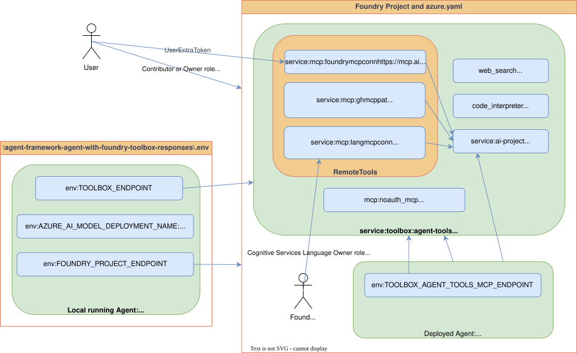.  

You can read about some of the tools in the drawing [here](https://learn.microsoft.com/en-us/azure/foundry/agents/concepts/toolbox-overview#supported-tools.).  

|[env](../10-projs/016-hosted-agent-py/src/agent-framework-agent-with-foundry-toolbox-responses/)|GET|USE|
|---|---|---|
|input:GITHUB_MCP_PAT|[Create](https://github.com/settings/personal-access-tokens) a [fine-grained PAT](https://docs.github.com/en/authentication/keeping-your-account-and-data-secure/managing-your-personal-access-tokens#creating-a-fine-grained-personal-access-token) with only the repository permissions|[Use PAT](https://github.com/github/github-mcp-server#install-in-vs-code) in VSCode|

Info: Foundry stores connections details in a **managed Azure Key Vault** if no Key Vault connection is created.  
Users that prefer to manage their secrets themselves can bring their own Azure Key Vault via a connection. 

##### GITHUB_MCP_PAT
The `GITHUB_MCP_PAT` is a token used from VSCode - then handed over to the agent, who then uses it.  
* In the table use link `fine-grained PAT` to create a PAT.  
* Then click buttom [VSCode Install server](https://github.com/github/github-mcp-server#remote-github-mcp-server).  
Just install it - don't grant it accees. 
* Find [JSON config for it here](https://github.com/github/github-mcp-server#install-in-vs-code)
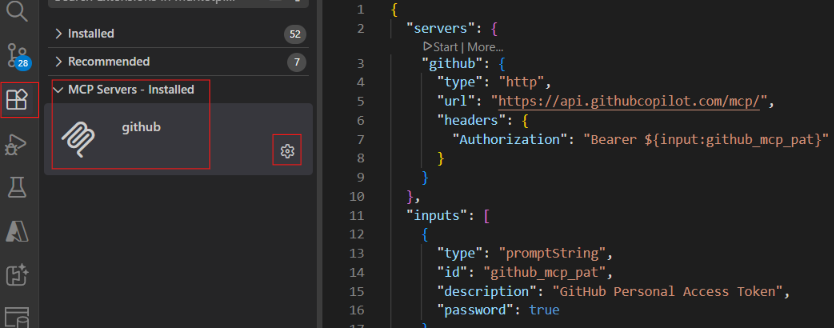
* Then in VSCode - Extensions - MCP Servers - Github
  * Press settings button - Show Configuration (JSON) - Paste the config you got.
  * Press settings button - Show configuration - Press settings button - Browse Resource
    * This will ask you to paste the PAT - do that
    * Now you dig into repos using the MCP

When you then use the MCP server (from the Local running Agent) it will ask for the PAT, so keep it ready.

I'll set 'GitHub' MCP up via Foundry Portal, so that credentials are stored in Foundry:  
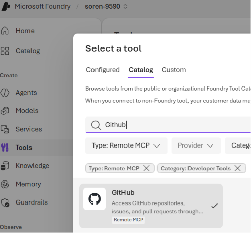  
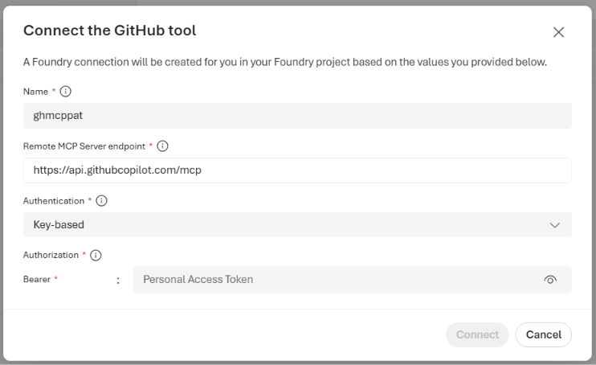

##### AZURE_LANGUAGE_MCP_ENDPOINT

I'll set 'Azure Language in Foundry' MCP up via Foundry Portal, so that credentials are stored in Foundry:  
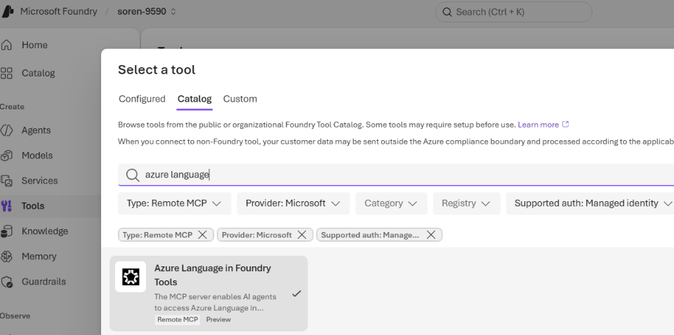  
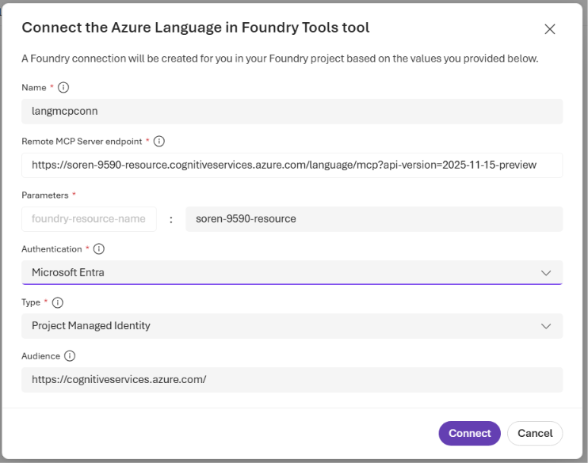

Now I can add to .env as used from azure.yaml:
```ini
AZURE_LANGUAGE_MCP_ENDPOINT="https://soren-9590-resource.cognitiveservices.azure.com/language/mcp?api-version=2025-11-15-preview"
```

##### Foundry remote MCP

I'll set 'Foundry' remote MCP up via Foundry Portal, so that credentials are stored in Foundry:  
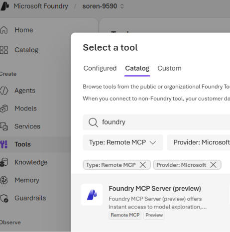  
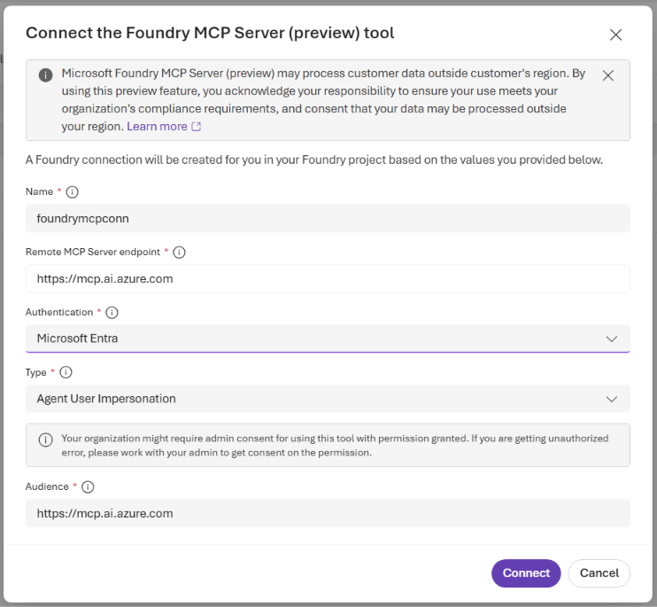

##### Tools available

In VSCode - Foundry Toolkit - Tools you can now see the added MCP tools and some built in tools:  
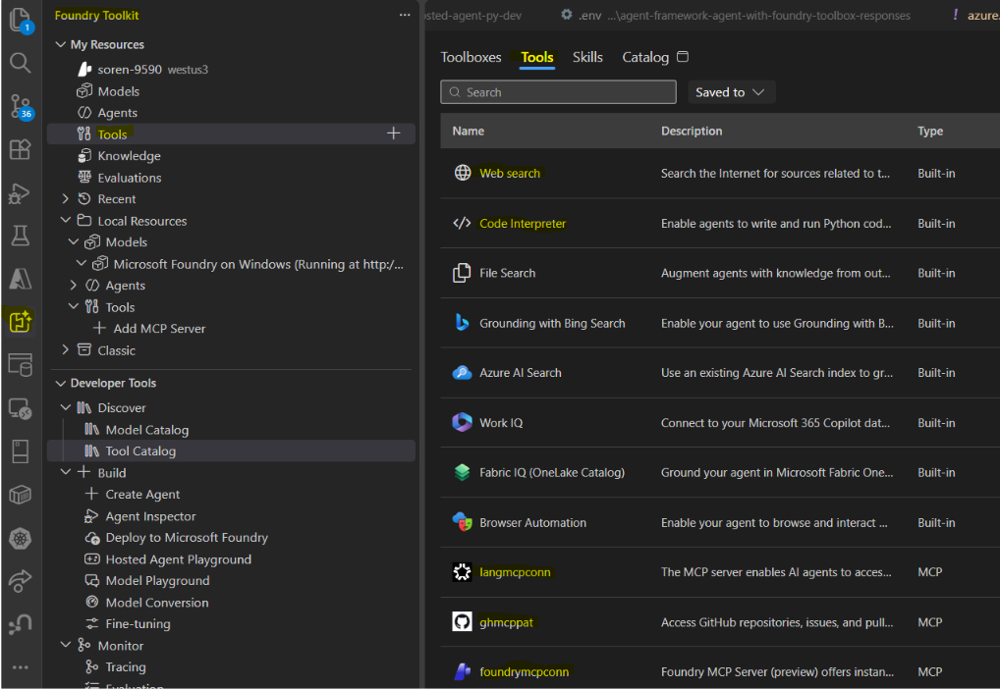

I expect the last MCP - 'noauth_mcp' - can be added automatic, when deploying, since there is no input, that is not in azure.yaml.

#### 2. Create toolbox

We could have used `azd ai toolbox create` to create a toolbox.  
Instead we want to use the declarations in `azure.yaml`

PS1:
```ps1
cd 016-hosted-agent-py
cd src\agent-framework-agent-with-foundry-toolbox-responses
az login
azd auth login
# set region same as where your Resource group
azd env set AZURE_LOCATION westus3
# upload template
azd provision

# if no errors deploy
# azd deploy --all

# verify deploy of toolbox succeeded by seeing this env have been set
# azd env get-value TOOLBOX_AGENT_TOOLS_MCP_ENDPOINT
```

Hmm.. some constraints in my setup between resource group and azure location for the azure.yaml ARM template gives errors, when provisioning...

Instead I'll create the toolbox in [Foundry Portal](https://ai.azure.com/).
* Tools - Toolboxes - Create Toolbox
* Name: agent-tools-016

Add the tools missing  
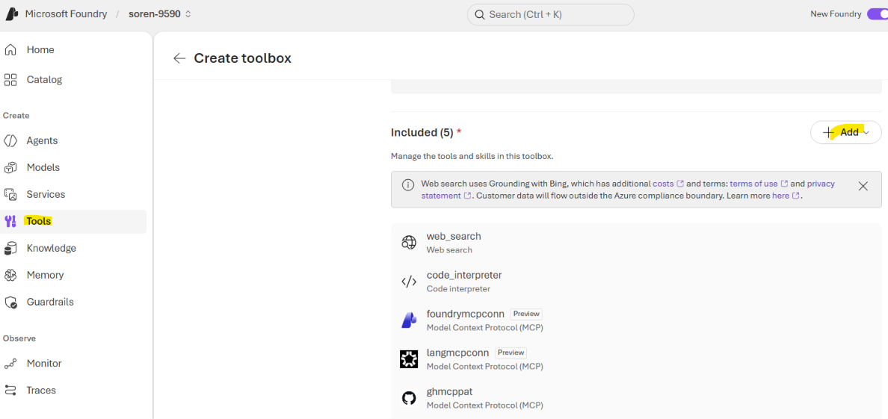

This gave med an endpoint which I can add to my agent settings:
```ps1
azd env set TOOLBOX_ENDPOINT https://soren-9590-resource.services.ai.azure.com/api/projects/soren-9590/toolboxes/agent-tools-016/mcp?api-version=v1
```

#### 3. Run agent locally 

PS1:
```ps1
cd src\agent-framework-agent-with-foundry-toolbox-responses
az login
# Compile and run
python main.py
```
Lots of json tracing was returned:
```log
2026-11-15 12:57:22,959 INFO azure.ai.agentserver: Tracing configured successfully via microsoft-opentelemetry distro.
...
2026-11-15 12:57:23,271 INFO hypercorn.error: Running on http://0.0.0.0:8088 (CTRL + C to quit)
CTRL + C
2026-11-15 13:05:43,312 INFO azure.ai.agentserver: AgentServerHost shutting down (graceful timeout=30s)
```

Lets get some help
```bash
azd ai agent --help
# v1.0.0-beta.19 
# Visit the docs at https://aka.ms/azd-ai-agent-docs

# Ship prompt, hosted, and voice agents with Microsoft Foundry from your terminal. (Preview)

# Usage
#   azd ai agent [command]

# Available Commands
#   code         : Manage agent source code. (Preview)
#   connection   : Manage connection service dependencies for an agent.
#   delete       : Delete a prompt, hosted, or voice agent.
#   doctor       : Diagnose problems with an azd ai agent project.
#   endpoint     : Inspect agent endpoints and manage hosted endpoint/card configuration.
#   eval         : Create and run quick evals for an agent.
#   files        : Manage files in a hosted agent session.
#   init         : Initialize a new prompt, hosted, or voice agent project. (Preview)
#   invocations  : Inspect and manage work created by invoking an agent.
#   invoke       : Send a message to your prompt or hosted agent.
#   monitor      : Monitor logs from a hosted agent.
#   optimize     : Evaluate and optimize AI agents.
#   pack         : Build a ready-to-sideload Teams app package for an activity agent.
#   publish      : Publish an activity agent as a Teams app to the Microsoft 365 store.
#   run          : Run your agent locally for development.
#   sample       : Browse the curated catalog of agent samples and azd templates.
#   sessions     : Manage sessions for a hosted agent endpoint.
#   show         : Show the status of a prompt, hosted, or voice agent.
#   state-stores : Inspect hosted-agent State Stores and manage their items.
#   toolbox      : Manage toolbox service dependencies for an agent.
#   version      : Prints the version of the application

# Global Flags
#   -C, --cwd string         : Sets the current working directory
#       --debug              : Enables debug and diagnostics logging
#   -e, --environment string : The name of the environment to use
#   -h, --help               : help for agent
#       --no-prompt          : Runs without prompts. Uses existing values; fails if any required value or decision cannot be resolved automatically.
#   -o, --output string      : The output format (default "default")

# Examples
#   Initialize and deploy an agent project
#     azd ai agent init
#     azd up

#   Send a message to a deployed prompt or hosted agent
#     azd ai agent invoke "Hello"

# Use azd ai agent [command] --help to view examples and more information about a specific command.

# Environments & Environment Variables
#   An azd environment is a named deployment configuration, such as dev or prod.
#   Its values are stored locally in .azure/<environment>/.env.
#   Use 'azd env new <name>' to create one, 'azd env select <name>' to change the
#   default, or --environment <name> (-e) to select one for a command.

#   Use 'azd env set <name> <value>' to save a value and 'azd env get-values' to
#   inspect the selected environment. Values can include secrets; do not share
#   the output or commit .azure to source control.

#   FOUNDRY_PROJECT_ENDPOINT identifies the Foundry project. Init records it
#   when you select an existing project; generated azure.yaml files reference
#   it as ${FOUNDRY_PROJECT_ENDPOINT} to keep configuration portable.
#   Deploy records AGENT_<SERVICE>_NAME, AGENT_<SERVICE>_VERSION and
#   AGENT_<SERVICE>_PROJECT_ENDPOINT so commands can resolve deployed agents.
#   <SERVICE> is the service name in uppercase with spaces and hyphens replaced
#   by underscores (for example, my-agent becomes MY_AGENT).

#   For hosted agent runtime settings, use the service-level env mapping in
#   azure.yaml. Reference environment values with ${VARIABLE_NAME}; setting an
#   azd environment value alone does not forward every value to the agent.
#   Use 'azd ai agent run' for local development and 'azd deploy' to apply changes
#   to the deployed agent.

# Learn More
#   Agent documentation: https://aka.ms/azd-ai-agent-docs
```

Lets learn some more...
```bash
azd ai agent endpoint show
# ERROR: no Foundry project endpoint resolved
# Suggestion: persist a workspace default with `azd ai project set <endpoint>`, or set FOUNDRY_PROJECT_ENDPOINT in the active azd environment, or export FOUNDRY_PROJECT_ENDPOINT in your shell

azd env set FOUNDRY_PROJECT_ENDPOINT https://soren-9590-resource.services.ai.azure.com/api/projects/soren-9590
azd env set AZURE_AI_MODEL_DEPLOYMENT_NAME gpt-5-mini
azd env set TOOLBOX_ENDPOINT https://soren-9590-resource.services.ai.azure.com/api/projects/soren-9590/toolboxes/agent-tools-016/mcp?api-version=v1

azd ai agent endpoint show
# ERROR: failed to get agent "agent-framework-agent-with-foundry-toolbox-responses": GET https://soren-9590-resource.services.ai.azure.com/api/projects/soren-9590/agents/agent-framework-agent-with-foundry-toolbox-responses
```
Wrong command - we checked if the agent was deployed. It is not deployed. We just want to run it locally atm.


```bash
azd ai agent run                           # Run locally on http://localhost:8088
```
A local webpage for interacting with the local agent pupped up
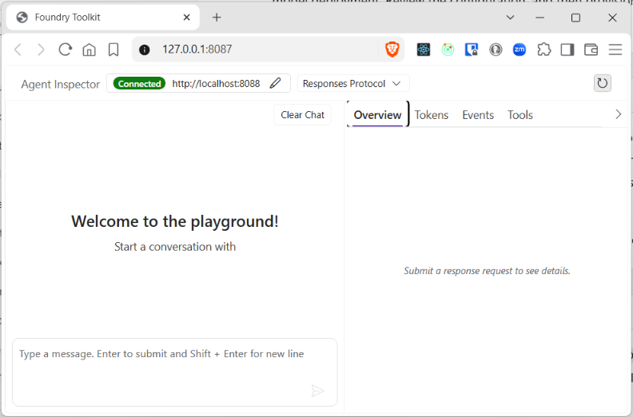

Sent it this message: "List the tools you can use.".
It fetched two tools and failed on 3:
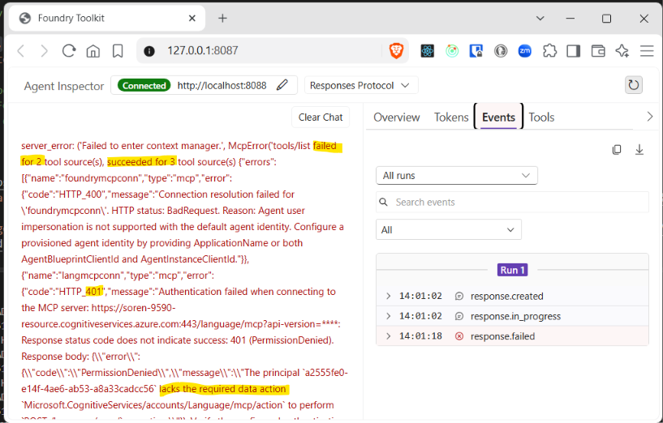

So seemingly we have hole through to the toolbox, but are having some issues with permissions on some tools.  

```bash
# in another console:
azd ai agent invoke --local "List the tools you can use." # Test the local agent
# azd ai agent invoke --local "Find the latest release notes for the Azure CLI on the web."

# azd deploy                                 # Deploy to Foundry
# azd ai agent invoke "your message"         # Invoke the deployed agent
```
### References
* [Role-based access control for Microsoft Foundry](https://learn.microsoft.com/en-us/azure/foundry/concepts/rbac-foundry?tabs=owner%2Cfoundry)
* [Configure keyless authentication with Microsoft Entra ID](https://learn.microsoft.com/en-us/azure/foundry/foundry-models/how-to/configure-entra-id?tabs=python&pivots=ai-foundry-portal)
* [MCP — Microsoft Entra (Agent Identity / Project Managed Identity)](https://github.com/microsoft-foundry/foundry-samples/blob/main/samples/python/hosted-agents/SUPPORTED_TOOLBOX_SCENARIOS/tools/mcp-microsoft-entra.md)

---